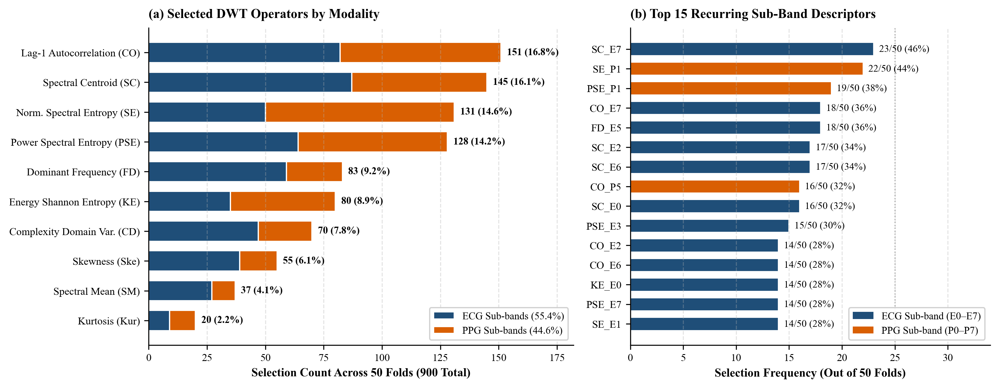
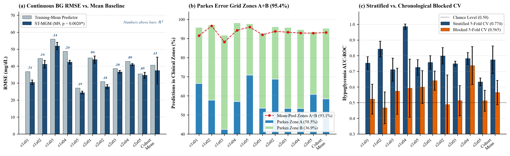
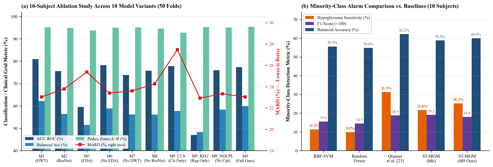

# ST-MGM: Spatiotemporal Multimodal Deep Learning Framework for Non-Invasive Blood Glucose Estimation and Hypoglycemia Detection

Official PyTorch implementation of **"ST-MGM: A Spatiotemporal Multimodal Deep Learning Framework for Non-Invasive Blood Glucose Estimation and Hypoglycemia Detection Using Wearable ECG, PPG, and EDA Signals"**.

**Authors:** Rani Megasari¹, Muhammad 'Azmi Salam¹\*, Muhammad Rafi Valliansyah¹  
*¹AI and Data Science Research Group, Universitas Pendidikan Indonesia, Bandung, 40154, Indonesia*  
*\*Corresponding author: `muhammadazmi36@upi.edu`*

---

## 1. Overview

**ST-MGM (Spatiotemporal Multimodal Glucose Monitor)** is a hybrid multi-task deep learning framework that jointly performs **binary hypoglycemia detection ($\text{BG} < 70\text{ mg/dL}$)** and **continuous blood glucose concentration estimation ($\text{mg/dL}$)** from uniform 5-minute (300-second) wearable recordings of Electrocardiography (ECG, 250 Hz), Photoplethysmography (PPG, 64 Hz), and Electrodermal Activity (EDA, 4 Hz).

### Key Architectural Components
1. **Branch A — Temporal Statistical Wavelet Branch ($\mathbf{F}_{\text{temporal}} \in \mathbb{R}^{18}$):**
   - Applies 7-level Daubechies-4 (`db4`) Discrete Wavelet Transform (DWT) decomposition across 8 sub-bands per cardiovascular modality ($s_0^{\text{raw}}, cD_1, \dots, cD_7$ for ECG and PPG).
   - Extracts 10 time-frequency statistical, spectral, and entropy descriptors per sub-band (`Kur, Ske, SM, SC, FD, CD, CO, PSE, KE, SE`), yielding $160$ candidate features ($80\text{ ECG} + 80\text{ PPG}$).
   - Performs strictly fold-isolated, **scale-invariant three-stage hybrid feature selection**:
     1. *Scale-Invariant Unsupervised & Mutual-Relevance Filtering (UFS)* ($\sigma > 10^{-6}$ filter, Z-score standardization, and correlation relevance-to-redundancy ranking to top $K_{\text{UFS}} = 80$).
     2. *L1-Regularized Lasso Selection (L1-FS)* ($\lambda = 0.02$ on standardized glucose targets).
     3. *Recursive Feature Elimination (RF-RFE)* ($50$ class-balanced decision trees, step $= 5$, top $K_{\text{RFE}} = 18$).
     - Candidate sets $I_{\text{L1}} \cup I_{\text{RFE}}$ are ranked by combined normalized importance $s_j^{(\text{L1})} + s_j^{(\text{RF})}$ to retain $18$ features per fold.
2. **Branch B — Spatial Morphological 1D-ResNet Branch ($\mathbf{F}_{\text{morphological}} \in \mathbb{R}^{40}$):**
   - Segments 3-second R-peak ECG beats ($750$ samples) and systolic-peak PPG pulses ($192$ samples) via NeuroKit2, aggregates correlation-filtered clean median beat templates ($r \ge 0.5$), and processes them through a dual-branch 5-layer 1D-ResNet backbone ($[32, 64, 128, 128]$) followed by a 3-layer DNN compression head ($256 \to 512 \to 128 \to 40$ with LayerNorm, GELU, and Dropout).
3. **Branch C — Autonomic Electrodermal Branch ($\mathbf{F}_{\text{eda}} \in \mathbb{R}^{64}$):**
   - Encodes Z-score normalized 5-minute EDA sequences ($1,200$ samples at 4 Hz) using two strided Conv1D downsampling blocks ($1200 \to 199 \to 39$) and a Bidirectional LSTM ($d_h = 32 \times 2 \to 64$, concatenating $\mathbf{F}_{\text{eda}} = [\vec{h}_{39} \parallel \overleftarrow{h}_{1}]$).
4. **Intermediate Multi-Task Fusion & Threshold-Aware Logit Coupling:**
   - Concatenates branch-normalized representations into $\mathbf{F}_{\text{fusion}} \in \mathbb{R}^{122}$ and maps them through a shared MLP ($122 \to 64 \to 32$) with a linear residual skip connection from the temporal branch ($18 \to 32$).
   - Couples the continuous glucose regression output $\hat{y}_{\text{reg}}$ directly into the classification logit via a learnable margin below the clinical $70\text{ mg/dL}$ threshold:
     $$z_{\text{cls}} = \mathbf{w}_{\text{cls}}^\top \mathbf{z}_{\text{shared}} + b_{\text{cls}} + \text{softplus}(\gamma)\cdot(\tau_{70} - \hat{y}_{\text{reg}})$$

---

## 2. Repository Structure

```text
physio-stf/
├── configs/
│   └── st_mgm_config.yaml          # Full architectural, preprocessing, and training configuration
├── libs/
│   ├── dataloader.py               # PyTorch Dataset, Stratified & Chronological Blocked CV split loaders
│   ├── dwt_features.py             # 7-level db4 DWT extraction & scale-invariant UFS + L1 + RFE selection
│   ├── helper.py                   # Signal filtering, beat segmentation, and utility functions
│   └── st_mgm_model.py             # ST-MGM PyTorch architecture (1D-ResNet, Conv1D-BiLSTM, Coupled MLP)
├── results/                        # Complete 140 experiment folders across 10 subjects & summary tables
│   ├── figures/                    # Publication-ready figures (300 DPI PNG)
│   ├── dataset_summary_table.md    # Per-subject window & hypoglycemia distribution table
│   ├── dataset_summary.json        # Machine-readable dataset statistics
│   ├── phase6b_analysis_summary.md # Full 10-subject statistical summary & Wilcoxon tests
│   └── phase6b_analysis_summary.json
├── preprocess_raw.py               # Step 1: Raw PhysioCGM waveform synchronization & beat segmentation
├── preprocess_features.py          # Step 2: DWT feature extraction & leak-free per-fold CV split building
├── train.py                        # Step 3: Multi-task ST-MGM training (Stratified / Blocked CV & Ablations)
├── test.py                         # Step 4: Fold & Pooled OOF evaluation (AUC, AUPRC, R2, Parkes Error Grid)
├── run_baselines.py                # Classical ML (RBF-SVM, Random Forest) & Deep Learning (Quamer et al.) baselines
├── run_experiments.py              # Master orchestrator for multi-subject ablations, baselines, and Blocked CV
├── generate_dataset_table.py       # Generates per-subject dataset summary tables (.md, .tex, .json)
├── analyze_results.py              # Aggregates all 140 experiment folders & runs paired Wilcoxon tests
├── generate_paper_figures.py       # Generates high-resolution manuscript figures from Phase 6B results
└── requirements.txt                # Python dependencies
```

---

## 3. Dataset & Post-Preprocessing Window Distribution

This repository evaluates on the public **PhysioCGM** dataset ([Quamer et al., *Scientific Data* 2025](https://doi.org/10.1038/s41597-025-06090-6); [Figshare DOI: 10.6084/m9.figshare.28136294](https://doi.org/10.6084/m9.figshare.28136294)), comprising 10 Type 1 Diabetes (T1D) participants monitored in unconstrained daily life. After synchronizing 5-minute ECG, PPG, and EDA segments with ground-truth Dexcom G6 CGM readings, the valid dataset distribution is as follows:

| Subject | Cohort | Valid Windows ($N_{\text{window}}$) | Hypo Windows ($< 70$ mg/dL) | Normal Windows ($\ge 70$ mg/dL) | Hypo Prevalence (%) | Glucose Mean $\pm$ SD (mg/dL) | Stratified Val Hypo / Fold | Blocked Val Hypo / Fold |
| :--- | :--- | :---: | :---: | :---: | :---: | :---: | :---: | :---: |
| `c1s01` | Cohort 1 | 2,027 | 130 | 1,897 | 6.41% | 113.57 $\pm$ 36.83 | 26/26/26/26/26 | 54/12/24/37/3 |
| `c1s02` | Cohort 1 | 2,888 | 8 | 2,880 | 0.28% | 155.58 $\pm$ 44.59 | 2/2/2/1/1 | 4/0/0/4/0 |
| `c1s03` | Cohort 1 | 2,710 | 83 | 2,627 | 3.06% | 145.33 $\pm$ 55.99 | 16/16/17/17/17 | 22/30/6/19/6 |
| `c1s04` | Cohort 1 | 2,324 | 6 | 2,318 | 0.26% | 152.82 $\pm$ 48.75 | 1/1/1/2/1 | 0/6/0/0/0 |
| `c1s05` | Cohort 1 | 2,850 | 112 | 2,738 | 3.93% | 108.94 $\pm$ 27.16 | 22/22/22/23/23 | 48/17/0/0/47 |
| `c2s01` | Cohort 2 | 2,858 | 129 | 2,729 | 4.51% | 124.46 $\pm$ 44.84 | 26/26/26/25/26 | 19/4/19/62/25 |
| `c2s02` | Cohort 2 | 2,488 | 155 | 2,333 | 6.23% | 109.02 $\pm$ 30.93 | 31/31/31/31/31 | 2/31/37/2/83 |
| `c2s03` | Cohort 2 | 2,240 | 48 | 2,192 | 2.14% | 135.79 $\pm$ 38.61 | 9/9/10/10/10 | 10/31/0/4/3 |
| `c2s04` | Cohort 2 | 3,248 | 90 | 3,158 | 2.77% | 135.77 $\pm$ 42.84 | 18/18/18/18/18 | 1/45/8/25/11 |
| `c2s05` | Cohort 2 | 3,148 | 190 | 2,958 | 6.04% | 109.75 $\pm$ 35.55 | 38/38/38/38/38 | 31/54/41/9/55 |
| **Total / Mean** | **10 Subjects** | **26,781** | **951** | **25,830** | **3.55%** | **129.10 $\pm$ 40.61** | **~19.0 / fold** | **~19.0 / fold** |

---

## 4. Installation & Reproducibility Guide

### 4.1 Environment Setup
```bash
git clone https://github.com/zicofarry/physio-stf.git
cd physio-stf
python -m venv venv
source venv/bin/activate  # On Windows: .\venv\Scripts\activate
pip install -r requirements.txt
```

### 4.2 Preprocessing & Fold-Isolated Feature Selection
Place the raw PhysioCGM subject folders (`1`–`5` under Cohort 1 and Cohort 2) into `./dataset/` and run:
```bash
# 1. Extract 5-minute synchronized trimodal segments & clean median beat templates
python preprocess_raw.py --subject all

# 2. Extract 160 DWT features & build leak-free Stratified and Blocked 5-fold splits (30-min purge gap)
python preprocess_features.py --subject all --purge_gap 6
```

### 4.3 Training & Evaluation
```bash
# Train & evaluate full ST-MGM (M9) under Stratified 5-Fold CV across all 10 subjects
python train.py --subject all --ablation M9 --cv_mode stratified
python test.py --subject all --ablation M9 --cv_mode stratified

# Train & evaluate ST-MGM (M9) under Chronological Blocked 5-Fold CV (30-min purge gap)
python run_experiments.py --mode blocked_stmgm --subjects all --purge_gap 6

# Run 10-variant multi-subject ablation study (M1..M9, M9_CLS, M9_REG, M9_NOCOUPLE)
python run_experiments.py --mode ablation --subjects all

# Run multi-subject baselines (RBF-SVM, Random Forest, and Quamer et al. Late-Fusion replication)
python run_experiments.py --mode baselines --subjects all --baseline_device cpu

# Generate statistical Wilcoxon summary tables & publication figures
python generate_dataset_table.py
python analyze_results.py
python generate_paper_figures.py
```

---

## 5. Main Experimental Results

### 5.1 Scale-Invariant DWT Feature Selection Across 50 Folds
Across 50 training folds ($900$ total selections), **55.44% ($499/900$)** of selected features originate from ECG and **44.56% ($401/900$)** from PPG, with all 10 operators represented (`CO` 16.78%, `SC` 16.11%, `SE` 14.56%, `PSE` 14.22%, `FD` 9.22%, `KE` 8.89%, `CD` 7.78%, `Ske` 6.11%, `SM` 4.11%, `Kur` 2.22%).



### 5.2 10-Subject Multi-Task Performance (`M9` vs. Training-Mean Baseline & Blocked CV)
- **Stratified 5-Fold CV (10-Subject Mean $\pm$ SD):** AUC-ROC = **0.774 $\pm$ 0.088**, AUPRC = **0.201 $\pm$ 0.129**, Balanced Accuracy = **60.01% $\pm$ 4.32%**, Sens@90%Spec = **45.29% $\pm$ 19.94%**, RMSE = **37.42 $\pm$ 7.86 mg/dL** (vs. Training-Mean Predictor **40.59 $\pm$ 8.12 mg/dL**, paired Wilcoxon **$p = 0.0020^*$** across $N=10$ subjects and **$p = 7.56 \times 10^{-10\text{**}}$** across $N=50$ folds), $R^2$ = **0.148 $\pm$ 0.082**, MARD = **23.04% $\pm$ 3.27%**, Pearson $r$ = **0.388 $\pm$ 0.106**, and Parkes Zones A+B = **95.37% $\pm$ 2.04%**.



### 5.3 Multi-Subject Ablation Study & Baseline Comparison (50 Folds per Model)

| Model / Variant | Description | AUC-ROC | AUPRC | F1-Score | Bal. Acc (%) | Sens / Spec (%) | RMSE (mg/dL) | $R^2$ | MARD (%) | Parkes A+B (%) | Wilcoxon $p$ vs. `M9` (Fold / Subj) |
| :--- | :--- | :---: | :---: | :---: | :---: | :---: | :---: | :---: | :---: | :---: | :---: |
| **Training-Mean** | Constant Training-Fold Mean | 0.500$\pm$0.000 | 0.036$\pm$0.021 | 0.000$\pm$0.000 | 50.00$\pm$0.00 | 0.00 / 100.0 | 40.59$\pm$8.12 | 0.000 | 26.26$\pm$3.59 | 93.15$\pm$2.25 | RMSE: <0.0001\*\* / 0.0020\* |
| **RBF-SVM** | 122-D $\mathbf{F}_{\text{fusion}}$ + SVC / SVR | 0.807$\pm$0.088 | 0.278$\pm$0.163 | 0.156$\pm$0.145 | 55.53$\pm$6.42 | 11.30 / 99.75 | 37.68$\pm$7.80 | 0.136 | 21.64$\pm$2.85 | 95.47$\pm$1.96 | F1: 0.0200\* / 0.426; BalAcc: 0.0001\*\* / 0.131 |
| **Random Forest** | 122-D $\mathbf{F}_{\text{fusion}}$ + RF (200 trees) | 0.838$\pm$0.062 | 0.345$\pm$0.173 | 0.145$\pm$0.136 | 54.84$\pm$5.03 | 9.86 / 99.82 | 32.81$\pm$6.50 | 0.341 | 20.81$\pm$3.26 | 95.75$\pm$1.87 | F1: 0.0244\* / 0.301; BalAcc: <0.0001\*\* / 0.0273\* |
| **Quamer et al. [23]** | Late Fusion (InceptionTime + BiLSTM) | 0.777$\pm$0.093 | 0.187$\pm$0.103 | 0.189$\pm$0.090 | 62.23$\pm$6.26 | 31.32 / 93.15 | 37.11$\pm$7.35 | 0.159 | 23.69$\pm$3.44 | 94.88$\pm$2.20 | MARD: 0.0013\* / 0.0059\*; A+B: 0.0057\* / 0.0488\* |
| **M2 (Morph Only)** | Branch B: 1D-ResNet (40-D) | 0.756$\pm$0.105 | 0.175$\pm$0.139 | 0.148$\pm$0.117 | 56.44$\pm$5.02 | 17.27 / 95.60 | 37.95$\pm$8.00 | 0.123 | 23.79$\pm$3.58 | 94.91$\pm$2.08 | BalAcc: 0.0019\* / 0.0137\*; RMSE: 0.0018\* / 0.0371\* |
| **M3 (EDA Only)** | Branch C: Conv1D-BiLSTM (64-D) | 0.595$\pm$0.100 | 0.066$\pm$0.030 | 0.056$\pm$0.054 | 51.49$\pm$2.07 | 8.70 / 94.28 | 40.66$\pm$8.18 | -0.006 | 25.38$\pm$3.26 | 93.76$\pm$2.28 | AUC: <0.0001\*\* / 0.0020\*; RMSE: <0.0001\*\* / 0.0020\* |
| **M6 (No EDA)** | Branches A + B (ECG+PPG, 58-D) | 0.782$\pm$0.099 | 0.252$\pm$0.216 | 0.191$\pm$0.105 | 58.89$\pm$4.88 | 21.64 / 96.14 | 37.17$\pm$8.01 | 0.160 | 23.40$\pm$3.71 | 95.00$\pm$2.17 | A+B vs. M9: 0.0002\*\* / 0.0098\* |
| **M7 (No DWT)** | Branches B + C (ResNet+EDA, 104-D) | 0.739$\pm$0.090 | 0.183$\pm$0.096 | 0.145$\pm$0.126 | 56.18$\pm$5.20 | 16.28 / 96.09 | 38.13$\pm$7.83 | 0.112 | 23.61$\pm$3.38 | 95.10$\pm$2.06 | AUC: 0.0027\* / 0.0371\*; RMSE: <0.0001\*\* / 0.0273\* |
| **M8 (No ResNet)** | Branches A + C (DWT+EDA, 82-D) | 0.758$\pm$0.104 | 0.159$\pm$0.089 | 0.135$\pm$0.088 | 56.11$\pm$4.30 | 17.24 / 94.97 | 38.26$\pm$7.71 | 0.109 | 24.27$\pm$3.50 | 94.62$\pm$2.40 | BalAcc: 0.0003\*\* / 0.0039\*; RMSE: 0.0004\*\* / 0.0488\* |
| **M9\_CLS** | Single-Task Classification ($\alpha=1,\beta=0$) | 0.778$\pm$0.097 | 0.203$\pm$0.166 | 0.154$\pm$0.106 | 57.73$\pm$4.88 | 19.33 / 96.13 | 45.42$\pm$9.27 | -0.259 | 27.47$\pm$2.91 | 92.79$\pm$2.66 | F1: 0.152 / 0.0039\*; BalAcc: 0.058 / 0.0273\* |
| **M9\_REG** | Single-Task Regression ($\alpha=0,\beta=1$) | 0.470$\pm$0.064 | 0.042$\pm$0.027 | 0.038$\pm$0.031 | 48.32$\pm$6.26 | 14.73 / 81.92 | 37.01$\pm$7.76 | 0.167 | 22.93$\pm$3.32 | 95.27$\pm$1.87 | AUC: <0.0001\*\* / 0.0020\*; MARD: 0.559 / 0.432 |
| **M9\_NOCOUPLE** | Multi-Task Without Logit Coupling ($\gamma \equiv 0$) | 0.760$\pm$0.092 | 0.188$\pm$0.140 | 0.187$\pm$0.107 | 58.40$\pm$4.42 | 20.91 / 95.90 | 37.41$\pm$7.83 | 0.149 | 23.33$\pm$3.55 | 95.12$\pm$2.09 | AUPRC: 0.0461\* / 0.275; MARD: 0.0372\* / 0.0371\* |
| **ST-MGM (`M9`)** | **Full Trimodal + Coupled Multi-Task (122-D)** | **0.774$\pm$0.088** | **0.201$\pm$0.129** | **0.180$\pm$0.102** | **60.01$\pm$4.32** | **25.22 / 94.80** | **37.42$\pm$7.86** | **0.148** | **23.04$\pm$3.27** | **95.37$\pm$2.04** | **Reference Model** |



---

## 6. License & Acknowledgments

This research was supported by the Riset Kolaborasi Indonesia (RKI) grant from Lembaga Penelitian dan Pengabdian kepada Masyarakat (LPPM), Universitas Pendidikan Indonesia. The experimental evaluation uses the open-access [PhysioCGM dataset](https://doi.org/10.6084/m9.figshare.28136294) collected at Baylor College of Medicine under IRB protocol H-49867.
